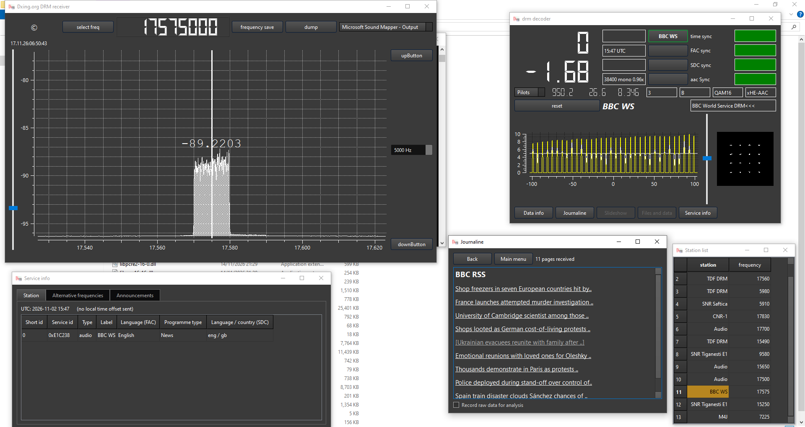
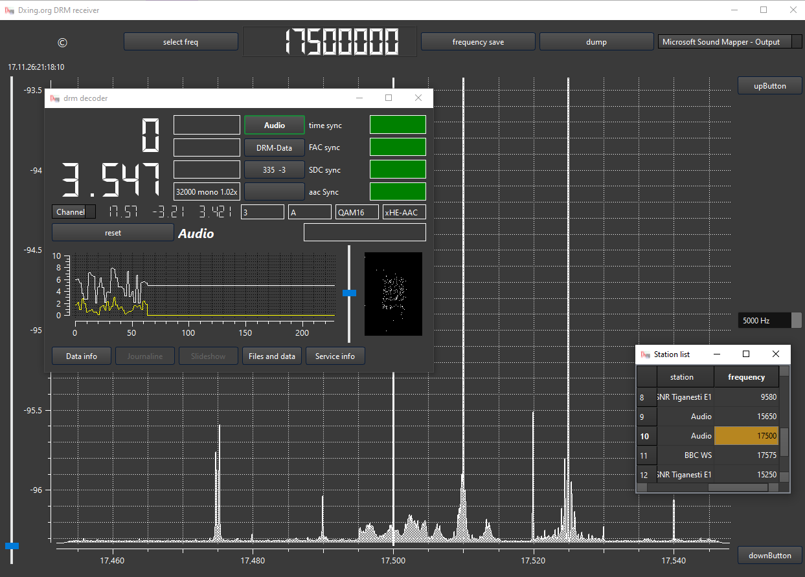
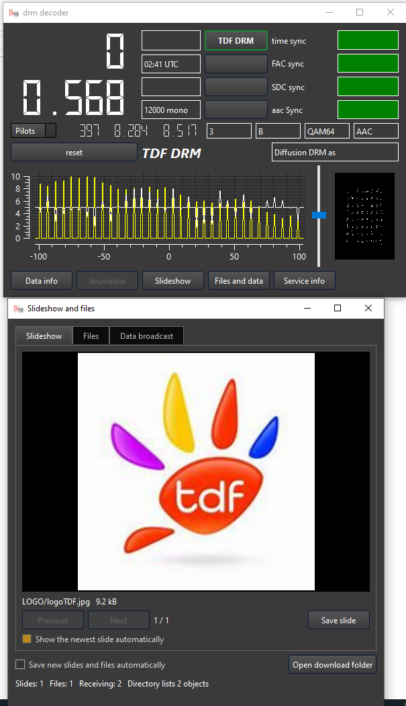
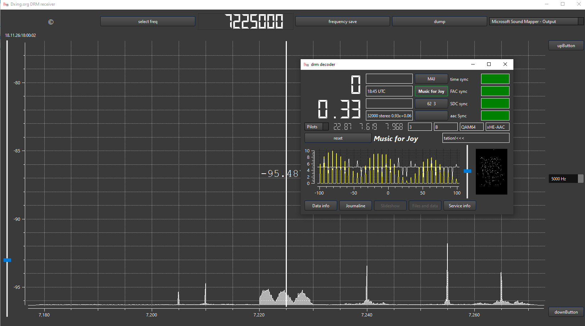
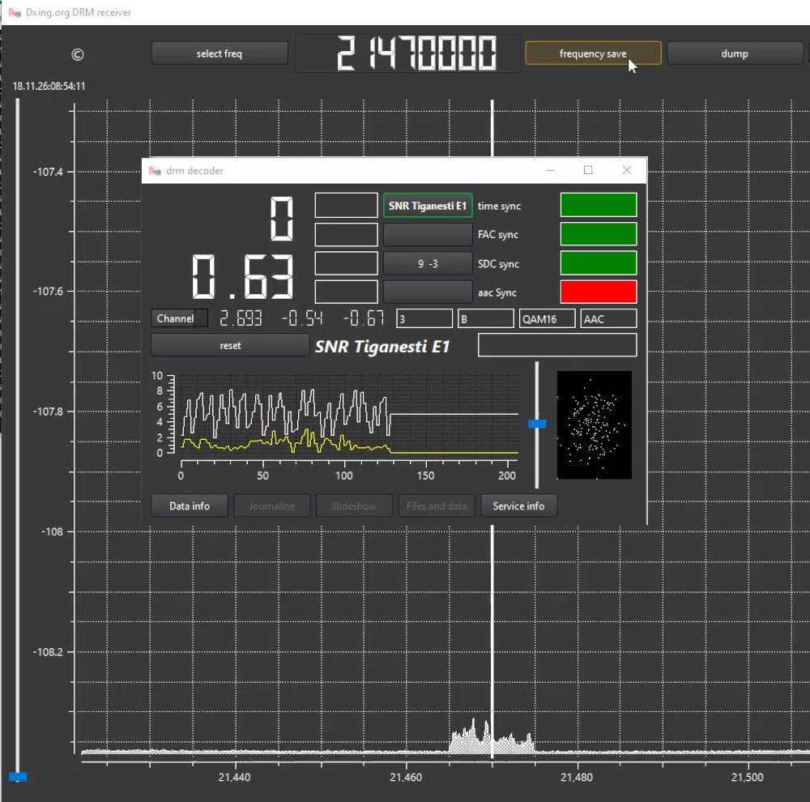
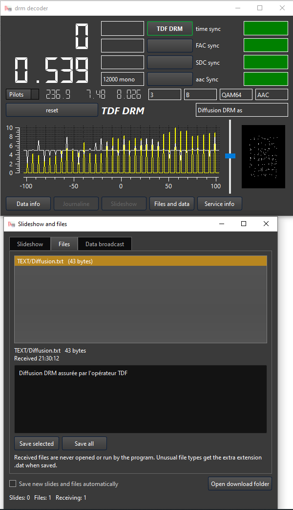
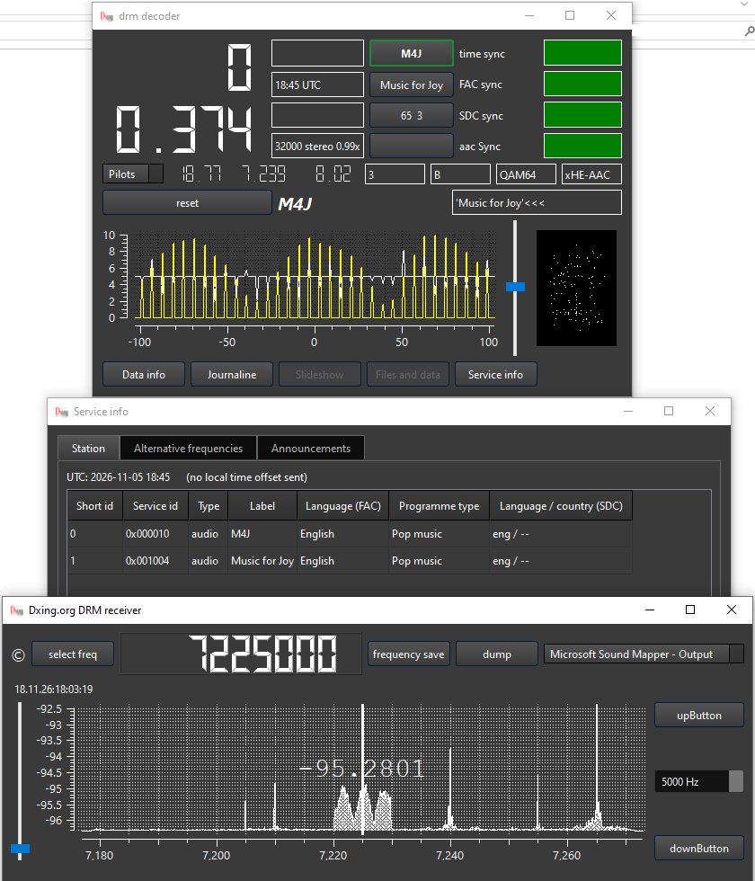

# Dxing.org DRM receiver

A Windows-ready fork of [**drm-receiver** by Jan van Katwijk](https://github.com/JvanKatwijk/drm-receiver),
a Qt6/C++ receiver for **DRM30** (Digital Radio Mondiale, medium/short wave) with an
SDR as front end.

This fork adds support for the AirSpy HF+ Discovery and AirSpy R2, a native
**64-bit Windows build** with a portable package, and a lot of work on the **data
services** of DRM: Journaline, MOT slide show and files, the Chinese data broadcast
(GY/T 423-2025), service information, and tools to find out why a signal does not
decode. The DRM decoder itself is the one of the original.

> **Status: experimental, hobby project.** It is tested on the signals and receivers
> listed below, not more. See [Known limitations](#known-limitations).

BBC World Service  

CNR  

TDF  

Music for Joy  

SNR Tiganesti E1  

TDF  

M4J  

## Download

Ready-made Windows packages are in the
[**Releases**](../../releases) section (unzip the whole folder, run
`Dxing-DRM-receiver.exe`; no installation, no administrator rights; Windows 10/11,
64-bit).

> **The AAC decoder library is not in the package.** Stations with AAC or xHE-AAC
> sound (almost all DRM stations) need `libfdk-aac-2.dll`, which has its own licence
> (Fraunhofer FDK AAC). You add it yourself, once: see the section **"AAC DECODER"**
> in the `README.txt` of the package (it takes about five minutes with MSYS2).
> Without it the program starts, tells you so, and everything except the sound of
> AAC stations works.

## What is new compared with the original

**Receivers and platform**
- Drivers for the **AirSpy HF+ Discovery** and the **AirSpy R2** (with SpyVerter).
- A native **Windows 64-bit** build (MinGW cross build in a Docker container) and a
  **portable package** (`Dxing-DRM-receiver-win64-*.zip`) with the Qt libraries and
  the receiver driver DLLs.
- Own name, logo and icon; station list kept as a UTF-8 text file; keypad to type a
  frequency; 5 kHz step; slider 0-100 with Auto.

**Data services** (all received content is shown or saved only on your click; nothing
received is ever opened or run)
- **Journaline** (ETSI TS 102 979): text pages and menus in their own window.
- **MOT** (ETSI EN 301 234): header and directory mode, **slide show** (TS 101 499),
  files, with automatic repetition handling.
- **Chinese data broadcast** (GY/T 423-2025, clause 6.7, e.g. emergency broadcast):
  messages and files, including a **carousel assembler** that builds large packets
  from several repetitions of the station's loop, and a progress display ("3 of 6
  packets"). Pictures sent this way (JPEG, PNG, GIF) appear in the Slideshow.
- **Data info** window: what the station sends (data streams, packets, errors) and a
  **raw recording** of the received data for bug reports.

**Service information**
- **Service info** window: services, labels, language, programme type (FAC/SDC),
  date and time (UTC and local), alternative frequencies (double click a DRM
  frequency to tune to it), announcements and an **alarm** indication.
- Labels and the choice of sound are kept **per service** (a station can have two
  services that share one audio stream, as Musik 4 Joy); the chosen service is marked
  and its name is used in the station list.
- Noise that passes the 8-bit CRC of the FAC no longer shows services that do not
  exist.

**Audio**
- xHE-AAC speed diagnostics and error concealment instead of long silences after a
  damaged frame; a corrected channel index for xHE-AAC stereo (not tested with a stereo
  stream yet).

**Fixes**
- Crash when a receiver could not be opened, crash on closing with the file reader,
  old station name after a frequency change, wrong characters in texts, scale of the
  spectrum, uninitialised fields in the file reader.

The complete list per version is in [CHANGELOG.md](CHANGELOG.md).

## Using it

1. Choose the receiver from the list (or `filereader` to play an IQ recording).
2. Type a frequency with **select freq** or tune with the spectrum.
3. The window **drm decoder** shows the decoding state. Buttons at the bottom:
   **Data info**, **Journaline**, **Slideshow**, **Files and data**, **Service info**.
   A button is active when the station sends that kind of content.
4. **Quit** with the X of the main window "Dxing.org DRM receiver".

Settings and the station list are stored in your user folder
(`.drm-radio.ini`, `.drm-radio-stations.txt`, `Dxing-DRM\`), not in the program folder.

## Building

See [docs/BUILDING.md](docs/BUILDING.md). In short: Docker Desktop (with WSL on
Windows), the `Dockerfile` in `windows-build/`, then `qmake` and `make` in the
container, and `collect-dlls.sh` / `make-portable.sh` to make the package.

## Known limitations

- Receivers available to the maintainer: AirSpy HF+ Discovery, AirSpy R2 (+SpyVerter),
  HackRF, RTL-SDR v3. Tests were done with live reception and IQ recordings of BBC WS
  (Journaline), TDF (MOT), the Chinese DRM service on 17500 kHz, Music 4 Joy and CNR-1.
- **Not tested**: SDRplay (64-bit path), SpyServer, sound card input.
- Alternative frequencies, announcements and the alarm bits are read as the standard
  describes but only tested with synthetic data; the meaning of the announcement
  bits is partly an assumption (shown with the raw value).
- A **picture received through the Chinese data broadcast** has not been seen on a real
  signal yet; the one file received so far was of unknown type.
- With a weak signal the receiver loses synchronisation often (this is the behaviour of
  the original decoder; no change was made to it).
- The program is not digitally signed: Windows SmartScreen asks once ("More info",
  "Run anyway").

## Bug reports

Please attach what the program already records: in **Data info** press **Save log**
(and, for data problems, tick **Record raw data for analysis** and send
`Dxing-DRM\data-groups.txt`). Say the receiver, the frequency and the version.

## Licence and credits

Free software under the **GNU General Public License, version 2** (see
[COPYING](COPYING)). The original program, **drm-receiver**, and the DRM decoder are
by **Jan van Katwijk** (Lazy Chair Computing), see [AUTHORS](AUTHORS) and
[README-upstream.md](README-upstream.md) (the README of the original). This fork is
by Dxing.org. The source code of every released build is this repository.

Third-party libraries used by the program, each under its own licence: Qt 6, Qwt,
FFTW, PortAudio, libsndfile, libsamplerate, libusb and the receiver drivers
(libairspy, libairspyhf, libhackrf, librtlsdr). The **Fraunhofer FDK AAC** codec
(libfdk-aac) is **not distributed with this program**; you add it yourself (see above).
